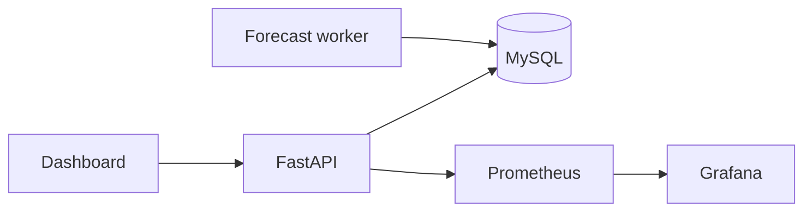

# FreshLedger

FreshLedger is a single-store food inventory app for the **Automated CI/CD Pipeline for Optimizing Food Inventory Management in Retail Stores** project. It tracks batch expiry, records stock movements, and forecasts seven days of demand. The project includes the application and the pipeline that tests, scans, deploys, and monitors it.

## Run the demo

Install and start Docker Desktop, or use Docker Engine with Docker Compose v2. Extract the ZIP and open a terminal in the `freshledger` folder.

**Windows PowerShell**

```powershell
Copy-Item .env.example .env
docker compose up -d --build
docker compose ps -a
```

**WSL, Linux, or macOS**

```bash
cp .env.example .env
docker compose up -d --build
docker compose ps -a
```

| Open | Address | What you’ll see |
| --- | --- | --- |
| FreshLedger | [localhost:8080](http://localhost:8080) | Inventory, forecasts, and stock activity |
| API | [localhost:8080/docs](http://localhost:8080/docs) | Available API endpoints and request schemas |
| Prometheus | [localhost:9090](http://localhost:9090) | Application metrics and alert rules |
| Grafana | [localhost:3000](http://localhost:3000) | **Dashboards → FreshLedger → FreshLedger operations** |

Grafana’s demo login is `admin` / `freshledger-demo`. The first start can take several minutes while Docker downloads images and MySQL initializes. The `init` container should show **Exited (0)**. The worker publishes forecasts after it starts. See progress with `docker compose logs -f init app worker`. Use `docker compose down` to stop the services and keep the data.

## Demo walkthrough

1. Open **Overview** to see sellable units, upcoming expiry, projected waste, and stockout risk. The demo contains eight products, current stock batches, and 120 days of synthetic sales per product.
2. Open **Inventory**, select a product, and choose **Receive stock**. Enter a unique batch code, quantity, and expiry date.
3. Select **Record sale** and enter a quantity. FreshLedger deducts it from the earliest-expiring sellable batches first. Each allocation appears in **Activity**.
4. Open **Classic Hummus**, select its expired batch, and choose **Discard**. Confirm the quantity and reason, then check the activity ledger.
5. Open **Forecast**, select a product, and compare the random forest and moving-average errors. The table shows the daily values plotted in the chart.
6. Open the Grafana dashboard after using the app so it has HTTP requests to chart. See [Jenkins setup and experiment](ops/JENKINS.md) for demonstrating a Git push through the release pipeline.

## Frontend

The interface uses dated stock labels to surface expiring batches, waste, and stockout decisions. Inventory can be sorted by next expiry. The forecast screen provides a table of the daily values shown in the chart. The appearance picker offers Light, Dark, and System, and saves the preference in the browser.

FreshLedger uses the UI design, design system, and accessibility guidance from [Donniedarko45/Skills at commit 9300e25](https://github.com/Donniedarko45/Skills/tree/9300e2521c7e238947ee475d9945413a9ae649ff/frontend). The interface is served by FastAPI with plain HTML, CSS, and JavaScript. Manrope is bundled with its SIL Open Font License in `inventory/static/fonts/`.

## What the app does

| Area | Behavior |
| --- | --- |
| Catalog | Add and edit product details, search by name or SKU, and filter by category and stock status. |
| Stock | Record receipts with expiry dates, sell by first-expiry-first-out (FEFO), and discard quantities with a reason. Expiry dates are inclusive through the end of the store day. |
| Consistency | Each movement and its quantity changes commit together. Stock writes lock the product in MySQL. A retried movement with the same operation ID and inputs returns the original result. |
| Stock rules | Expired units are excluded from sales. A reorder point flags low stock even when a product has no forecast. |
| Forecast alerts | The app simulates projected sales and expiry in date order, using current batch quantities and subtracting any sales already logged today from today's forecast. Projected waste counts units expected to remain when a batch expires. Stockout risk counts forecast units that current stock cannot cover, assuming no new receipts. |

## How the model works

- The worker forecasts today and the following six store days. It checks for a new store date every minute, then trains and publishes once per day. Manual refresh is available with `docker compose run --rm --no-deps worker python -m inventory.commands forecast`.
- The baseline uses the mean of recorded, usable sales from the last seven days. The random forest uses target weekday, forecast horizon, recent sales lags, and 7- and 28-day averages. The latest 21 calendar days form a chronological validation window. A validation prediction only uses sales available before its forecast date of origin.
- The forecast uses up to 180 days of history. The app can publish a baseline with at least seven recorded usable days overall and at least three in the last week. It attempts a model comparison once there are at least 56 usable days and enough training and validation points. The random forest is published only when it has lower mean absolute error (MAE). MAE is measured in units, so an MAE of 2 means an average absolute error of two units per product-day prediction in the validation set.
- Unknown days and days flagged as stockouts are excluded from training and scoring. The system flags depletion from recorded sales or discards. Historical imports can flag other stockout days and record genuine zero-sales days. Alerts are projections from the available data. The synthetic scores demonstrate the model workflow, and real retail accuracy must be measured against real sales.

## Start with real stock

Use a fresh database or a separate Compose project, such as `docker compose --env-file .env.live -p freshledger-live up -d --build`. In the new environment file, set `SEED_DEMO=0`, choose passwords, and change the published ports if the demo is running. Initialization preserves any existing database and never replaces live records with demo data.

Create the SKUs in the web app before importing history. Use an Excel-compatible UTF-8 CSV with one row per SKU and completed store date. Example values of the format follow.

```csv
sku,date,units,stockout
DAI-101,2026-01-04,12,0
DAI-101,2026-01-05,0,0
DAI-101,2026-01-06,3,1
```

Set `stockout` to `1` when the product was unavailable for part or all of the day. Importing adds historical sales used by the model. The import leaves inventory quantities unchanged and rolls back entirely if a row is invalid or conflicts with existing sales.

```bash
docker compose --env-file .env.live -p freshledger-live run --rm --no-deps \
  -v "$(pwd)/sales.csv:/input/sales.csv:ro" worker \
  python -m inventory.commands import-sales /input/sales.csv

docker compose --env-file .env.live -p freshledger-live run --rm --no-deps worker \
  python -m inventory.commands forecast
```

`APP_USERNAME` and `APP_PASSWORD` enable a shared HTTP Basic login. The demo binds to loopback. Keep it private, or place it behind HTTPS before allowing remote access. The app is a single-store project with a shared login. Deployments requiring user-level permissions, a shared enterprise account system, or database schema evolution will need those features added.

## Develop without Docker

Use Python 3.12. This mode stores a local SQLite file in `.data/` and runs only the app. Use Compose for the MySQL and monitoring stack.

```bash
python -m venv .venv
source .venv/bin/activate              # WSL, Linux, and macOS
# Windows PowerShell activation uses .venv\Scripts\Activate.ps1
python -m pip install -r requirements-dev.txt
python -m inventory.commands init --demo
python -m inventory.commands forecast
python -m uvicorn inventory.asgi:app --host 127.0.0.1 --port 8080
```

Run `python -m inventory.commands worker` in another terminal for daily refresh. Run tests with `python -m pytest -q` and lint with `python -m ruff check inventory tests`. Tests skip the MySQL cases unless `TEST_MYSQL_URL` points at a disposable database called `freshledger_test`. The Jenkins test stage starts its own temporary MySQL service.

## Runtime layout



| Path | Purpose |
| --- | --- |
| `inventory/static/` | HTML, CSS, and browser JavaScript |
| `inventory/main.py`, `inventory/stock.py` | API, validation, and transactional stock updates |
| `inventory/forecast.py`, `inventory/dashboard.py` | Forecasting, evaluation, and inventory projections |
| `tests/` | Forecast, movement, API, and sales-import checks |
| `compose.yaml`, `ops/prometheus/`, `ops/grafana/` | MySQL, services, metrics, alerts, and dashboard |
| `Jenkinsfile`, `ops/deploy.sh` | CI/CD with quality and security gates, health checks, and rollback |

Follow the [Jenkins runbook](ops/JENKINS.md) for the CI job, SonarQube, Trivy, deployment, and a fair comparison of manual and automated release times.
